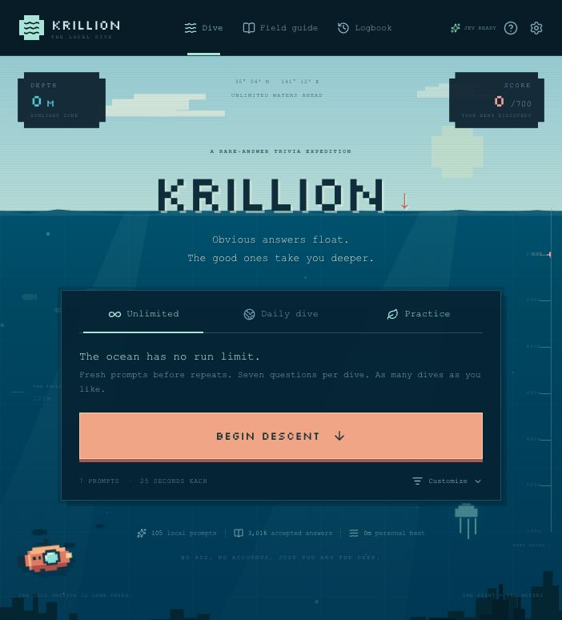
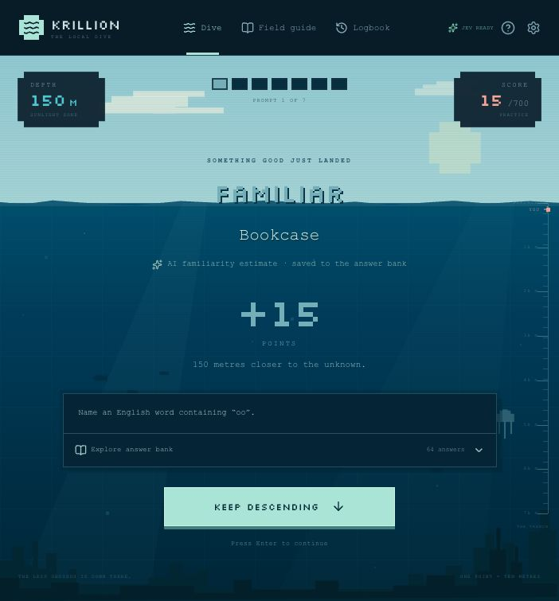

# Krillion

An unofficial, independently built local recreation of [Krillion](https://krillion.io). Name something that fits the prompt: familiar answers score a little, unusual answers take you deeper. Seven rounds make a dive, and every point adds ten metres.

**Play online:** [jordangeach.com/krillion](https://jordangeach.com/krillion/).



Players can run this recreation with no ads, account, or per-run limits. The bundled game works offline; optional Jev AI checking uses the website owner’s server-side TypeSafe key. Its artwork, interface, and curated question bank were built independently. It does not connect to the official game's servers or unlock paid content.

Source repository: [jordanbgeach/krillion-local](https://github.com/jordanbgeach/krillion-local).

105 bundled prompts • 3,014 curated canonical answers • 6 categories • Unlimited runs

**Version 1.3.0 is live.** It adds 54 prompts, saved prompt rotation, and 17,705 dictionary forms for seven word prompts. See the [1.3.0 release notes](docs/release-notes-1.3.0.md).

## Run locally

The bundled trivia game works offline once its dependencies are installed and the local build is created. AI checking requires an internet connection and a configured backend. You need **Node.js 22.13 or newer** to build it, and **Python 3** for the simple launcher.

For the prebuilt version, extract the [latest release](https://github.com/jordanbgeach/krillion-local/releases/latest) and double-click **Start Krillion.command**.

To build from source, run from this project folder:

```sh
npm install
npm run build:local
```

On macOS, double-click **Start Krillion.command**. The launcher opens [Krillion on your computer](http://127.0.0.1:4173) in your default browser. Keep its Terminal window open while playing; press Control-C there to stop the server. Reopening the launcher reuses a running server for this project.

On any platform with Python 3:

```sh
python3 scripts/serve.py
```

If Finder does not run the launcher after downloading a source ZIP, run `chmod +x "Start Krillion.command"` from the project folder, or use the Python command above. Opening `dist-local/index.html` directly is unsupported; use the local server.

To work on the app with live updates:

```sh
npm run dev:local
```

The development address is [http://127.0.0.1:5173](http://127.0.0.1:5173). Development and launcher addresses have separate browser saves because they use different ports.

## Play

- **Unlimited:** start as many seven-round dives as you like. Saved shuffle bags use fresh prompts before repeats, then reshuffle the next cycle into new groups. Each category combination has its own rotation.
- **Daily:** a deterministic dive based on your computer's local date.
- **Practice:** play without time pressure and learn from the accepted-answer list.
- Choose categories, adjust the timer, or replay a seed. Compact `d2-` codes record the chosen seven prompts and replay them with the same bank and category selection. The replay input is consumed once; **Dive again** in Unlimited or Practice starts a fresh draw.
- Review your dives in the logbook, and export your saves before moving computers or clearing browser storage.
- Extend the game with custom questions and scores through the custom-bank tools.

The default timed format is seven prompts with 25 seconds each. Type one answer and submit it before time runs out. Exact curated names, aliases, and matching dictionary forms score immediately. Other submitted answers are checked against the prompt by Jev when the backend is available; they do not have to appear in the bundled list. The game never replaces your answer with a nearby spelling automatically. If it offers spelling suggestions, select one and submit it yourself.

After an accepted answer, the depth counter and ruler move while the ocean camera descends past the surface, fish, landmarks, and deeper water. **Keep descending** becomes available when that movement finishes. The reduced-motion setting and your system’s reduced-motion preference snap directly to the new depth. After the reveal, inspect the answer bank to see what else you could have named.

| Score | Tier       |
| ----: | ---------- |
|    10 | Surface    |
|    15 | Familiar   |
|    30 | Shoal      |
|    60 | Uncommon   |
|    85 | Deep cut   |
|   100 | Hidden gem |

The highest possible seven-round score is 700 points, or 7,000 metres.

## What unlimited means

There is no play counter, paywall, or daily restriction on Unlimited mode. For random dives, a saved cycle bag uses every eligible prompt before drawing from the next cycle. The draw also avoids the previous seven prompts when alternatives remain and balances the available categories. Rotation is saved when a dive starts, so seeded, daily, and abandoned starts are remembered across reloads. Each category combination keeps a separate cycle bag. Explicit replays reproduce the requested seven prompts.

The 105-prompt bank is finite, so prompts eventually repeat. The next cycle reshuffles its groups, and custom prompts can expand the pool.

The curated scores are **manually estimated familiarity bands**, dictionary scores use **SCOWL inclusion bands**, and learned Jev scores are **AI familiarity estimates**. None is measured player popularity or Krillion’s official ranking. Curated scores take priority over dictionary or AI estimates. With AI available, unlisted answers can be checked against the actual prompt and added to the learned bank. Without AI, curated answers, matching dictionary forms, and previously learned answers remain available locally. Prompt notes explain the scope. Exact matching accepts normalized names and aliases, including accents, spacing, and punctuation differences where the prompt allows them. Nearby spellings are suggestions only.

Word-form prompts also enforce their stated structural rules before scoring: required prefixes or suffixes, adjacent letters, palindromes, single-word restrictions, or letter counts. Five-letter animal answers include ordinary plural names that meet the visible five-letter rule; single-word palindromes include `A` and `I`. For example, `colorless` fits a word ending in `less`, while `carelessness` does not. Passing a spelling rule does not by itself establish that an answer is a real word or fits the category. Old learned entries that violate these rules are excluded.

## Dictionary-backed word prompts

Seven pure letter prompts use 17,705 exact forms compiled from SCOWL: words beginning with `qu` or `z`, ending in `less`, containing adjacent `oo`, `ee`, or `ph`, and single-word palindromes. Membership and the prompt’s literal rule are both checked. These matches run instantly in the browser, work offline, and are mirrored on the PHP server without consuming inference quota. Curated answers retain their original scores. For example, `Catastrophically` is a dictionary-backed `ph` answer worth 30 points.

This is a finite dictionary subset, not an exhaustive list of every valid English word. Unknown words and answers needing semantic knowledge can still reach Jev. Dictionary membership does not establish an animal’s identity, a scientific field, or a silent initial letter. See the [dictionary provenance, scoring, and regeneration instructions](server/dictionary/README.md) and [SCOWL license](server/dictionary/SCOWL-LICENSE.txt).

## Custom question format

Custom banks use a JSON array. Supported categories are `Geography`, `Nature`, `Science`, `Culture`, `Words`, and `Food`. Each answer needs a name and one of the six scores above; aliases are optional. Prompt IDs are automatically prefixed with `custom-`.

```json
[
  {
    "id": "local-colours",
    "category": "Words",
    "prompt": "Name a colour in this sample bank.",
    "note": "A short example; add more accepted answers before playing.",
    "answers": [
      { "name": "Blue", "score": 10 },
      { "name": "Vermilion", "score": 85, "aliases": ["Vermillion"] },
      { "name": "Celadon", "score": 100 }
    ]
  }
]
```

Keep the answer sets accurate and include common alternatives. Imported banks are validated: unsupported categories, invalid scores, and conflicting names or aliases are rejected. A bank can contain up to 500 prompts with 300 answers per prompt.

## Saves and privacy

Progress, preferences, prompt rotation, custom questions, and a copy of learned answers stay in your browser’s local storage. The game includes no analytics or advertising scripts. Only after you submit an answer that needs AI judging are the current prompt and candidate sent through the game’s backend to TypeSafe; typing and local dictionary matches do not trigger judgment requests. The backend caches judgments and shares accepted answers; your dive history is not sent. The local Python launcher listens only on your computer’s loopback address.

Browser storage is tied to the browser profile and exact local address. Keep using `http://127.0.0.1:4173` for the same save. Export your data before changing browsers, clearing site data, or switching machines. The export includes your custom questions, dive history, and learned answers.

## Deploy to Hostinger at /krillion

Build the static upload package from the project folder:

```sh
npm install
npm run build:hostinger
```

This creates `dist-hostinger/` and `outputs/krillion-hostinger.zip`. The hosting build uses `/krillion/` for all application, font, and favicon URLs; it does not replace `dist-local/` or change the local launcher.

In Hostinger's File Manager for **jordangeach.com**, open `public_html/krillion/` (create the `krillion` folder if needed). Upload `krillion-hostinger.zip` there and extract its contents directly into that folder. The result must be `public_html/krillion/index.html`, with sibling `assets/`, `fonts/`, `favicon.svg`, and `.htaccess`; avoid nesting another `dist-hostinger` or `krillion` folder inside it. Upload only these generated files. Keep the rest of the existing website in place.

The included `.htaccess` selects `index.html` and enables the normal directory redirect from [jordangeach.com/krillion](https://jordangeach.com/krillion) to [jordangeach.com/krillion/](https://jordangeach.com/krillion/). The browser app is static. Optional AI checking uses the included PHP endpoint on Hostinger, with a private key file and cache outside the public web folder; no Node process or database server is required. After extraction, remove the uploaded ZIP from the public directory and verify the page, a new dive, and its font load at the public URL.

Hosted browser saves belong to the `https://jordangeach.com` origin and are separate from localhost saves. Use the game's backup export and import to transfer progress between them. Rebuilding and replacing the static files preserves existing browser saves.

## Jev AI checking and the learned bank

The server calls [TypeSafe’s System One API](https://docs.typesafe.ai/api/system-one) with one validity question and one rarity-tier question together. Jev is a decision model: it evaluates answers supplied by players instead of generating new trivia questions or word lists. Accepted candidates grow a cached, shared answer bank, with a local copy for fast repeat checks.

Exact curated names, aliases, and eligible dictionary forms are checked immediately in the browser. Other submitted answers get one deduplicated check; no judgment requests are made while you type. The availability badge is advisory, so a stale status result cannot prevent a submitted answer from reaching the backend. Structural word-rule failures are handled before AI inference.

A submitted AI check briefly pauses the prompt timer while the answer is locked. Rejected, uncertain, or unavailable checks preserve your unused time so you can try another answer. Uncertain and service-error results offer an explicit retry; rate-limit errors show a waiting period. Service failures are never treated as proof that the answer is invalid. Jev can still make factual mistakes, and its rarity scores remain estimates. First-check timing depends on Hostinger, the network, and TypeSafe.

On Hostinger, create `krillion-private/` **beside** `public_html/`, then put only the raw TypeSafe key in `krillion-private/api-key.txt`. Keep this folder outside the website. The PHP endpoint also accepts a `TYPESAFE_API_KEY` environment variable. The key is never bundled into JavaScript, sent to players, or committed to this repository. Server cache and rate counters live in that same private folder. See the backend documentation in `server/` for limits and failure handling.

For a local build to use your own hosted endpoint, create an ignored `.env.local` containing a public URL, not a key:

```dotenv
VITE_KRILLION_AI_ENDPOINT=https://your-domain.example/krillion/api.php
```

Then rebuild with `npm run build:local`. Without an endpoint override, local play stays local and continues with the bundled bank if no PHP service is present. API request limits apply to new server judgments; cached, curated, and dictionary-backed answers do not spend inference requests. Repeated runs themselves remain unlimited.

## Recorded verification

Version 1.3.0 passed 40 Node tests, 107 PHP 7.2 assertions, both production builds, and 23 live answer checks. The published assets, 105-prompt bank, and dictionary match the built files. Browser checks verified four distinct abandoned starts on the live site across a reload, immediate scoring of `Photocopying`, an exact seven-prompt encoded replay in the local preview, and a fresh **Dive again**. See the [deployment validation](docs/validation-1.3.0.json). AI validity and familiarity remain model judgments.

Version 1.2.0 passed 12 live regression checks after deployment, including unchanged acceptance of `Gambia` and `Powerless`, valid derived words, literal word-rule failures, and an invented word. A complete seven-round browser dive reached 7,000m with animated descent; the next timed round began with its full 25 seconds. Reduced motion and a 390px phone layout were also checked. See the [1.2.0 validation record](docs/validation-1.2.0.json).

The following smoke-check measurements were recorded for the earlier AI integration, before the 1.2.0 client fixes. They are a historical sample, not a response-time guarantee for every answer.

TypeSafe Jev was enabled on [jordangeach.com/krillion](https://jordangeach.com/krillion/). On November 7, 2026, eight fresh checks measured **278 ms median end-to-end** from the test computer (255–407 ms). Four unlisted valid answers were accepted; three invalid answers were rejected and one remained uncertain, with no points awarded. An invented word was also rejected in the live browser. The accepted answer “Bookcase” earned 15 points and joined the learned bank.

Known and already learned answers use the immediate browser lookup. The measured server-cache repeat took 3 ms on the backend, plus the network round trip. See [the recorded smoke checks](docs/ai-validation.json) and the live result below.



## Development and checks

```sh
npm test
npm run typecheck
npm run build:local
```

The standalone browser entry is `local-main.tsx`; the UI lives in `app/page.tsx` and `app/globals.css`. The ocean scene and depth-animation hook live in `components/ocean.tsx`. Exact matching, structural rules, scoring, seeded selection, and import validation live in `lib/engine.ts`. The AI client and learned-bank validation live in `lib/ai.ts`. Saved rotation and compact replay codes live in `lib/rotation.ts`; dictionary matching lives in `lib/lexicon.ts`. Original question banks live in `lib/data/`.

A [prebuilt local package](https://github.com/jordanbgeach/krillion-local/releases/latest) includes the browser game, Python server, and macOS launcher. Download and extract the whole package together; Python 3 is still needed, but Node.js is unnecessary to play the prebuilt copy. An optional GitHub Actions configuration lives in `.github/examples/check.yml`; move it to `.github/workflows/check.yml` if you enable workflow publishing on your GitHub credential.

## Credits and license

The original [Krillion](https://krillion.io) is the inspiration for the rare-answer game format. See its [FAQ](https://krillion.io/faq) for the original game's curation and scoring approach. This local recreation is unofficial and is not affiliated with or endorsed by the original Krillion creator. No official question-bank dumps, proprietary application code, official artwork, or paid content are included.

The bundled [Silkscreen font](https://github.com/google/fonts/tree/main/ofl/silkscreen) is licensed under the SIL Open Font License; see [the included font license](public/fonts/OFL.txt). It is served locally during play.

The compiled word evidence comes from the permissively licensed SCOWL / English Speller Database. Its provenance and build instructions are in the [dictionary README](server/dictionary/README.md); preserve the [SCOWL copyright and license notices](server/dictionary/SCOWL-LICENSE.txt) when redistributing that data.

This recreation's code and independently curated bank are released under the [MIT License](LICENSE). The third-party dictionary retains its own license.
