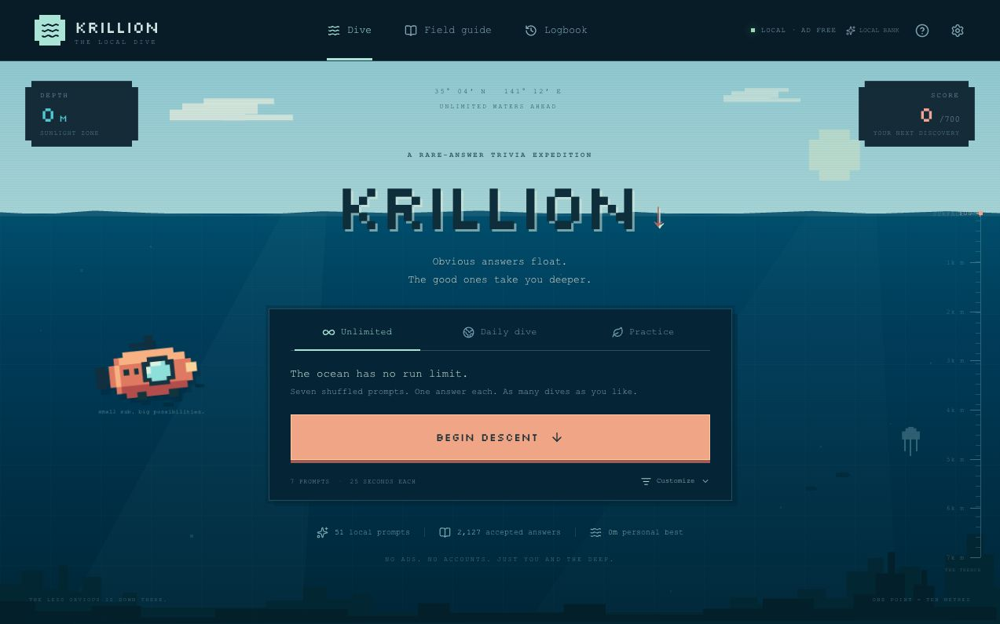

# Krillion

An unofficial, independently built local recreation of [Krillion](https://krillion.io). Name something that fits the prompt: familiar answers score a little, unusual answers take you deeper. Seven rounds make a dive, and every point adds ten metres.

**Play online:** [jordangeach.com/krillion](https://jordangeach.com/krillion/).



Players can run this recreation with no ads, account, or per-run limits. The bundled game works offline; optional Jev AI checking uses the website owner’s server-side TypeSafe key. Its artwork, interface, and curated question bank were built independently. It does not connect to the official game's servers or unlock paid content.

Source repository: [jordanbgeach/krillion-local](https://github.com/jordanbgeach/krillion-local).

51 bundled prompts • 2,127 accepted answers • 6 categories • Unlimited runs

## Run locally

The bundled trivia game works offline once its dependencies are installed and the local build is created. AI checking requires an internet connection and a configured backend. You need **Node.js 22.13 or newer** to build it, and **Python 3** for the simple launcher.

For the prebuilt version, extract the [latest release](https://github.com/jordanbgeach/krillion-local/releases/latest) and double-click **Start Krillion.command**.

To build from source, run from this project folder:

```sh
npm install
npm run build:local
```

On macOS, double-click **Start Krillion.command**. The launcher opens [Krillion on your computer](http://127.0.0.1:4173) in your default browser. Keep its Terminal window open while playing; press Control-C there to stop the server. Reopening the launcher reuses a running server for this project.

On any platform with Python 3:

```sh
python3 scripts/serve.py
```

If Finder does not run the launcher after downloading a source ZIP, run `chmod +x "Start Krillion.command"` from the project folder, or use the Python command above. Opening `dist-local/index.html` directly is unsupported; use the local server.

To work on the app with live updates:

```sh
npm run dev:local
```

The development address is [http://127.0.0.1:5173](http://127.0.0.1:5173). Development and launcher addresses have separate browser saves because they use different ports.

## Play

- **Unlimited:** start as many shuffled seven-round dives as you like. Random dives reroll to reduce overlap with your previous dive when possible, with a mix of your selected categories.
- **Daily:** a deterministic dive based on your computer's local date.
- **Practice:** play without time pressure and learn from the accepted-answer list.
- Choose categories, adjust the timer, or replay a seed. A shared seed reproduces a dive when the question bank and settings match.
- Review your dives in the logbook, and export your saves before moving computers or clearing browser storage.
- Extend the game with custom questions and scores through the custom-bank tools.

The default timed format is seven prompts with 25 seconds each. Type one answer and submit it before time runs out. After the reveal, inspect the local answer list to see what else you could have named.

| Score | Tier       |
| ----: | ---------- |
|    10 | Surface    |
|    15 | Familiar   |
|    30 | Shoal      |
|    60 | Uncommon   |
|    85 | Deep cut   |
|   100 | Hidden gem |

The highest possible seven-round score is 700 points, or 7,000 metres.

## What unlimited means

There is no play counter, paywall, or daily restriction on Unlimited mode. The bundled question bank is finite, so prompts eventually repeat; shuffling and category selection create different runs. You can add your own prompts to keep expanding it.

The bundled scores are **manually curated familiarity estimates**; learned Jev scores are **AI familiarity estimates**. Neither is measured player popularity or Krillion’s official ranking. With AI available, unlisted answers can be checked against the actual prompt and added to the learned bank. Without AI, the finite local bank determines what is accepted. Prompt notes explain the scope. Normalization accepts accents, spacing, and punctuation differences; conservative typo correction only accepts an unambiguous nearby answer.

## Custom question format

Custom banks use a JSON array. Supported categories are `Geography`, `Nature`, `Science`, `Culture`, `Words`, and `Food`. Each answer needs a name and one of the six scores above; aliases are optional. Prompt IDs are automatically prefixed with `custom-`.

```json
[
  {
    "id": "local-colours",
    "category": "Words",
    "prompt": "Name a colour in this sample bank.",
    "note": "A short example; add more accepted answers before playing.",
    "answers": [
      { "name": "Blue", "score": 10 },
      { "name": "Vermilion", "score": 85, "aliases": ["Vermillion"] },
      { "name": "Celadon", "score": 100 }
    ]
  }
]
```

Keep the answer sets accurate and include common alternatives. Imported banks are validated: unsupported categories, invalid scores, and conflicting names or aliases are rejected. A bank can contain up to 500 prompts with 300 answers per prompt.

## Saves and privacy

Progress, preferences, custom questions, and a copy of learned answers stay in your browser’s local storage. The game includes no analytics or advertising scripts. When AI checking is enabled, the current prompt and candidate answer are sent through the game’s backend to TypeSafe. The backend caches judgments and shares accepted answers; your dive history is not sent. The local Python launcher listens only on your computer’s loopback address.

Browser storage is tied to the browser profile and exact local address. Keep using `http://127.0.0.1:4173` for the same save. Export your data before changing browsers, clearing site data, or switching machines. The export includes your custom questions and dive history.

## Deploy to Hostinger at /krillion

Build the static upload package from the project folder:

```sh
npm install
npm run build:hostinger
```

This creates `dist-hostinger/` and `outputs/krillion-hostinger.zip`. The hosting build uses `/krillion/` for all application, font, and favicon URLs; it does not replace `dist-local/` or change the local launcher.

In Hostinger's File Manager for **jordangeach.com**, open `public_html/krillion/` (create the `krillion` folder if needed). Upload `krillion-hostinger.zip` there and extract its contents directly into that folder. The result must be `public_html/krillion/index.html`, with sibling `assets/`, `fonts/`, `favicon.svg`, and `.htaccess`; avoid nesting another `dist-hostinger` or `krillion` folder inside it. Upload only these generated files. Keep the rest of the existing website in place.

The included `.htaccess` selects `index.html` and enables the normal directory redirect from [jordangeach.com/krillion](https://jordangeach.com/krillion) to [jordangeach.com/krillion/](https://jordangeach.com/krillion/). The browser app is static. Optional AI checking uses the included PHP endpoint on Hostinger, with a private key file and cache outside the public web folder; no Node process or database server is required. After extraction, remove the uploaded ZIP from the public directory and verify the page, a new dive, and its font load at the public URL.

Hosted browser saves belong to the `https://jordangeach.com` origin and are separate from localhost saves. Use the game's backup export and import to transfer progress between them. Rebuilding and replacing the static files preserves existing browser saves.

## Jev AI checking and the learned bank

The server calls [TypeSafe’s System One API](https://docs.typesafe.ai/api/system-one) with one validity question and one rarity-tier question together. Jev is a decision model: it evaluates answers supplied by players instead of generating new trivia questions or word lists. Accepted candidates grow a cached, shared answer bank, with a local copy for fast repeat checks.

Known answers are checked immediately in the browser. Unknown answers are checked in the background after typing settles, and submission reuses that request. A submitted AI check briefly pauses the prompt timer while the answer is locked. Network errors and uncertain judgments are reported separately from a rejected answer. No response-time guarantee is implied: first checks depend on Hostinger, the network, and TypeSafe.

On Hostinger, create `krillion-private/` **beside** `public_html/`, then put only the raw TypeSafe key in `krillion-private/api-key.txt`. Keep this folder outside the website. The PHP endpoint also accepts a `TYPESAFE_API_KEY` environment variable. The key is never bundled into JavaScript, sent to players, or committed to this repository. Server cache and rate counters live in that same private folder. See the backend documentation in `server/` for limits and failure handling.

For a local build to use your own hosted endpoint, create an ignored `.env.local` containing a public URL, not a key:

```dotenv
VITE_KRILLION_AI_ENDPOINT=https://your-domain.example/krillion/api.php
```

Then rebuild with `npm run build:local`. Without an endpoint override, local play stays local and continues with the bundled bank if no PHP service is present. API request limits apply to new server judgments; cached and bundled answers do not spend inference requests. Repeated runs themselves remain unlimited.

## Development and checks

```sh
npm test
npm run typecheck
npm run build:local
```

The standalone browser entry is `local-main.tsx`; the UI lives in `app/page.tsx` and `app/globals.css`. Matching, scoring, seeded selection, and import validation live in `lib/engine.ts`. Original question banks live in `lib/data/`.

A [prebuilt local package](https://github.com/jordanbgeach/krillion-local/releases/latest) includes the browser game, Python server, and macOS launcher. Download and extract the whole package together; Python 3 is still needed, but Node.js is unnecessary to play the prebuilt copy. An optional GitHub Actions configuration lives in `.github/examples/check.yml`; move it to `.github/workflows/check.yml` if you enable workflow publishing on your GitHub credential.

## Credits and license

The original [Krillion](https://krillion.io) is the inspiration for the rare-answer game format. See its [FAQ](https://krillion.io/faq) for the original game's curation and scoring approach. This local recreation is unofficial and is not affiliated with or endorsed by the original Krillion creator. No official question-bank dumps, proprietary application code, official artwork, or paid content are included.

The bundled [Silkscreen font](https://github.com/google/fonts/tree/main/ofl/silkscreen) is licensed under the SIL Open Font License; see [the included font license](public/fonts/OFL.txt). It is served locally during play.

This recreation's code and independently curated bank are released under the [MIT License](LICENSE).
